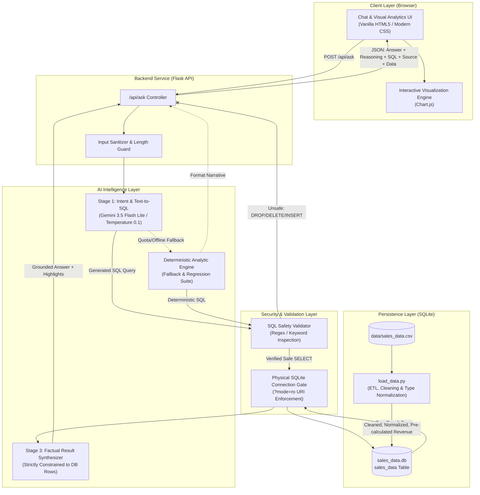
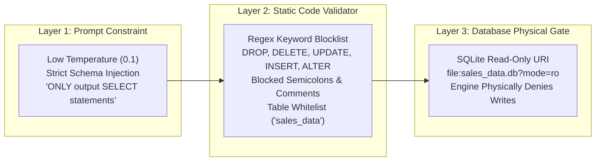

# System Architecture & Technical Design

## 1. System Overview

The **Mini AI Business Intelligence Assistant** is a full-stack decision-support system that translates natural language questions into deterministic, verified SQL queries against a sales transaction database.

Unlike conversational LLM systems that summarize or invent analytical figures, this system enforces **strict grounding**:
- The LLM is used only for **semantic translation** (natural language -> SQL) and **grounded synthesis** (database rows -> plain-English narrative).
- All calculations, sums, rankings, and filtering are performed deterministically by the relational database engine.
- Every answer comes with **step-by-step reasoning**, the **executed SQL**, and **complete source attribution** (database, table, rows evaluated, read-only mode).

---

## 2. End-to-End Data Flow



---

## 3. The 3-Tier Security & Validation Architecture

To prevent destructive database operations, three independent, layered defenses are implemented:



1. **Layer 1 (Model Level):** The system prompt injects exact table schema types, valid values, and explicit prohibitions against write operations. `temperature=0.1` keeps outputs consistent.
2. **Layer 2 (Code Level, `backend/sql_validator.py`):**
   - The query is inspected before it reaches SQLite.
   - Must match `^SELECT\b`.
   - Rejects semicolons, preventing multi-statement injection such as `SELECT 1; DROP TABLE sales_data`.
   - Rejects SQL comments (`--` and `/* */`) that could mask an injected payload.
   - Allows only the whitelisted `sales_data` table.
3. **Layer 3 (Database Level, `backend/query_executor.py`):**
   - The connection is opened with `sqlite3.connect("file:sales_data.db?mode=ro", uri=True)`.
   - Even if malicious SQL evaded Layers 1 and 2, SQLite returns `sqlite3.OperationalError: attempt to write a readonly database`.

---

## 4. Anti-Hallucination & Grounding Strategy

Hallucinations in analytical AI tools typically come from the LLM producing arithmetic or figures internally without grounding. This system prevents that with a **three-stage decoupled pipeline**:

| Stage | Responsibility | Grounding Mechanism |
|-------|----------------|---------------------|
| **Stage 1: Text-to-SQL** | Translates natural language into a SQL query | Schema injection restricts queries to real database columns. If the question is out of scope (e.g. weather, stock price), the model sets `is_answerable: false`. |
| **Stage 2: Database Execution** | Validates and runs the query | After validation, SQLite executes the SQL deterministically against 51 cleaned transactions over a read-only connection. |
| **Stage 3: Grounded Synthesis** | Summarizes the results in plain English | Gemini receives the **actual rows returned by the database** as read-only context and is constrained from introducing external numbers. |

### Source Attribution Metadata Returned With Every Response

```json
"source": {
    "database": "SQLite (sales_data.db)",
    "table": "sales_data",
    "rows_returned": 1,
    "columns_returned": ["product", "total_revenue"],
    "connection_mode": "Read-Only (mode=ro)"
}
```

---

## 5. Data Pipeline & Schema Design (ETL)

The input CSV contains sales transactions from Jan–Jun 2026. The ETL process (`backend/load_data.py`) cleans and normalizes the raw data:

```sql
CREATE TABLE sales_data (
    transaction_id TEXT PRIMARY KEY,   -- e.g., 'TXN0001'
    order_date TEXT,                   -- Converted from DD-MM-YYYY to ISO YYYY-MM-DD
    product TEXT,                      -- Categorical: Monitor, Desk, Keyboard, etc.
    category TEXT,                     -- Categorical: Electronics, Furniture, Accessories
    region TEXT,                       -- Categorical: North, South, East, West
    sales_channel TEXT,                -- Categorical: Online, Retail
    quantity INTEGER,                  -- Integer: handles 0 units (e.g., TXN0034)
    unit_price REAL,                   -- Float: handles NULL/missing values (e.g., TXN0051)
    discount_amount REAL,              -- Float: INR discount applied
    status TEXT,                       -- Categorical: 'Completed', 'Returned' (e.g., TXN0033)
    revenue REAL,                      -- Derived: (quantity * unit_price) - discount_amount
    order_month TEXT,                  -- Derived: 'YYYY-MM' for temporal grouping
    order_year INTEGER                 -- Derived: e.g. 2026
);
```

### Edge Cases Handled During Ingestion

1. **Missing Values (`TXN0051`):** `Unit_price` was empty. The loader sets `unit_price = NULL` and `revenue = NULL` instead of inserting a zero that would skew average-price calculations.
2. **Zero Quantity (`TXN0034`):** Handled as a zero-revenue transaction without arithmetic failure.
3. **Returned Status (`TXN0033`):** Stored with `status = 'Returned'`. Analytical queries apply `WHERE status = 'Completed'` so reversed revenue is not counted.
4. **Dates:** Normalized from `DD-MM-YYYY` to ISO `YYYY-MM-DD` so SQLite's lexicographic date ordering works correctly.